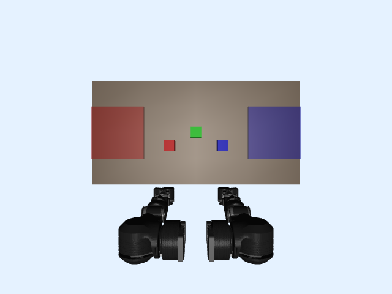
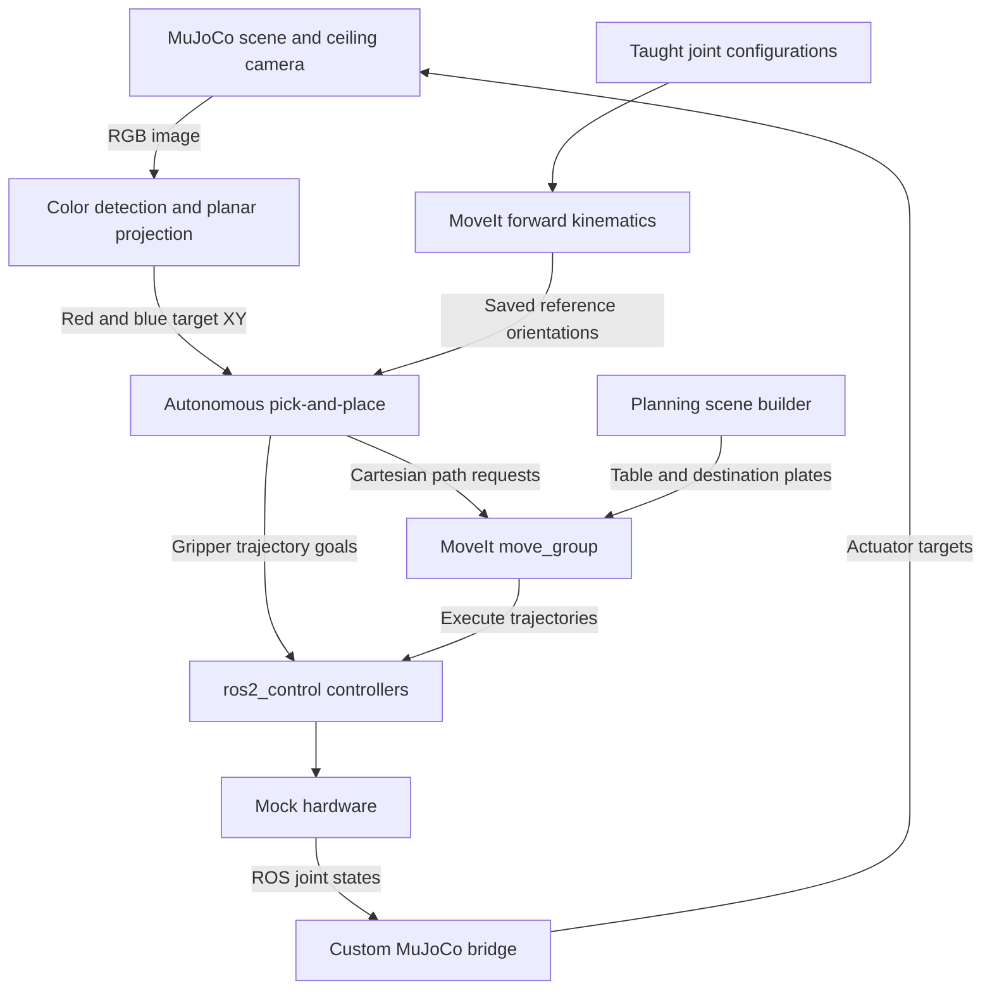

# OpenArm Vision Sorting

Vision-guided tabletop sorting with a simulated OpenArm dual-arm robot, ROS 2,
MoveIt 2, and MuJoCo.

An overhead RGB camera observes colored blocks on a table. A perception node
detects red and blue blocks and maps their image positions into planar world
coordinates. The manipulation application combines those coordinates with taught
end-effector orientations, requests Cartesian paths from MoveIt, and commands the
arms and grippers toward matching colored destination regions.



*Rendered starting scene from the bundled MuJoCo model. Red blocks are assigned
to the left arm and blue blocks to the right arm. The green block is currently
outside the sorting task. This image shows the scene, not a completed sorting run.*

**Status:** simulation prototype. The current application attempts one red/blue
sorting cycle per invocation. It uses mock ROS controller feedback and does not
independently verify grasp or placement success.

[Installation](#installation) · [Run](#run-the-sorting-demo) ·
[Teaching workflow](#teaching-and-forward-kinematics) ·
[Limitations](#current-limitations) · [Credits](#credits-and-license)

## Project goals and contributions

This project explores how robot descriptions, kinematics, perception, motion
generation, and ROS controllers fit together in a manipulation application.

The application work includes:

- A MuJoCo-to-ROS ceiling-camera publisher and ROS joint-state-to-actuator bridge.
- HSV color segmentation, contour filtering, and pixel-to-world coordinate mapping.
- Integration of a work table, blocks, and matching destination regions into the
  simulator and the MoveIt planning scene.
- Joint waypoint recording, forward-kinematics conversion, and playback experiments.
- A camera-driven pick-and-place sequence using MoveIt Cartesian paths and gripper
  trajectory actions.

The robot design, descriptions, meshes, and base OpenArm configurations come from
[OpenArm by Enactic](https://github.com/enactic). Kinematics solvers, motion
generation, and physics are provided by the underlying frameworks.

## How it works



1. The simulator publishes an overhead image on `/camera/ceiling/image_raw`.
2. The detector converts the image to HSV, filters red/blue contours by size and
   shape, and selects the nearest candidate for each assigned arm.
3. A pinhole camera model projects the selected pixels onto the known block-top
   plane. This is RGB-based planar localization; no depth image is used.
4. The task application captures the first target for each arm and waits for both.
5. Each arm attempts seven stages: pre-grasp, opening, approach, closing, transfer,
   release, and home. Target XY positions come from vision; orientations come from
   the taught pose file. Heights, tool offsets, and destination poses are configured
   directly in the application.

The two arm sequences are started as Python coroutines. This does not establish
coordinated simultaneous trajectory planning or execution; see the limitations.

## Reference environment

| Component | Local development environment |
|---|---|
| Operating system | Ubuntu 22.04.5 LTS |
| ROS 2 | Humble |
| Python | 3.10.12 |
| MoveIt 2 | Humble packages; local MoveIt metapackage version 2.5.10 |
| MuJoCo | 3.8.1 |
| OpenCV / NumPy | Ubuntu Python packages, used with ROS `cv_bridge` |
| Display | Desktop session with OpenGL support for MuJoCo and RViz |

The project has been built locally in this environment. These versions describe
the development setup; a clean-machine compatibility matrix and standardized
sorting benchmarks have not yet been established.

## Installation

### 1. Install ROS 2 Humble

Follow the official [ROS 2 Humble Ubuntu installation guide](https://docs.ros.org/en/humble/Installation/Ubuntu-Install-Debs.html).
The commands below assume its ROS apt repository is configured and Humble is
installed at `/opt/ros/humble`.

Install the build tools and application dependencies:

```bash
sudo apt update
sudo apt install \
  git python3-pip python3-colcon-common-extensions python3-rosdep \
  python3-opencv python3-numpy python3-scipy \
  ros-humble-moveit ros-humble-ros2-control ros-humble-ros2-controllers \
  ros-humble-cv-bridge ros-humble-xacro ros-humble-rqt-image-view

python3 -m pip install --user "mujoco==3.8.1"
```

The `mujoco` Python package provides the physics library and viewer used by the
bridge; see the [official Python documentation](https://mujoco.readthedocs.io/en/stable/python.html).
Use the Ubuntu OpenCV/NumPy packages with Humble's `cv_bridge` for this setup.

### 2. Clone the project

```bash
cd ~
git clone https://github.com/krrishbhansali/openarm-vision-sorting.git
cd openarm-vision-sorting
source /opt/ros/humble/setup.bash
```

OpenArm source snapshots, meshes, and the custom scene are bundled under `src/`.
Their base commits are recorded in [docs/upstream_versions.txt](docs/upstream_versions.txt).
The snapshots include local modifications; replacing them with pristine upstream
checkouts will not reproduce the same project configuration.

### 3. Resolve ROS dependencies

If rosdep has never been initialized on this machine, run `sudo rosdep init` once.
Then, from the repository root:

```bash
rosdep update
rosdep install \
  --from-paths \
    src/openarm_description \
    src/openarm_ros2/openarm_bringup \
    src/openarm_ros2/openarm_bimanual_moveit_config \
  --ignore-src --rosdistro humble -y
```

### 4. Build the simulation configuration

```bash
colcon build --symlink-install --packages-select \
  openarm_description \
  openarm_bringup \
  openarm_bimanual_moveit_config

source install/setup.bash
```

Build these three packages for the supported simulation workflow. The bundled
OpenArm hardware package and metapackage are not required by this demo. The custom
application nodes are currently standalone Python scripts in the repository.

## Run the sorting demo

### Terminal 1: simulation, MoveIt, and perception

```bash
cd ~/openarm-vision-sorting
source /opt/ros/humble/setup.bash
source install/setup.bash

ros2 launch openarm_bimanual_moveit_config master_bimanual.launch.py \
  workspace_root:="$PWD"
```

This starts RViz, MoveIt `move_group`, robot state publication, mock hardware and
trajectory controllers, the MuJoCo viewer and ceiling-camera bridge, the block
detector, and the planning-scene builder.

Keep `workspace_root:="$PWD"`: the inherited launch default points to `~/ros2_ws`.
If you clone into another directory, use that directory in the `cd` commands.

Wait for the controllers and detector to start. The detector should report a
left/red target and a right/blue target. Let the blocks settle on the table before
starting the task, because the application captures its first available targets.

### Terminal 2: autonomous sequence

```bash
cd ~/openarm-vision-sorting
source /opt/ros/humble/setup.bash
source install/setup.bash

python3 "Teaching and Playback/autonomous_pick_and_place.py"
```

The bundled `sequence_poses.json` is loaded relative to the script location.
Observe whether each block is actually picked up and reaches its matching region.
The current completion message alone is not proof of successful placement.

Use Ctrl+C in the task terminal after the attempt; its ROS executor keeps running.
To repeat the baseline scene, stop both terminals and relaunch Terminal 1 before
starting Terminal 2. This restores the original block positions.

## Inspect the ROS interfaces

Run these commands from another terminal after sourcing Humble and the overlay:

```bash
ros2 run rqt_image_view rqt_image_view
```

Select `/camera/ceiling/annotated` for detections and estimated coordinates, or
`/camera/ceiling/image_raw` for the original image.

```bash
ros2 topic echo /left_arm_target
ros2 topic echo /right_arm_target
ros2 control list_controllers
```

The `echo` commands run continuously; stop each with Ctrl+C or use separate
terminals.

| Interface | Type / purpose |
|---|---|
| `/camera/ceiling/image_raw` | `sensor_msgs/msg/Image`: rendered RGB image |
| `/camera/ceiling/annotated` | `sensor_msgs/msg/Image`: detection overlay |
| `/left_arm_target` | `geometry_msgs/msg/Point`: selected red block XY; Z is zero |
| `/right_arm_target` | `geometry_msgs/msg/Point`: selected blue block XY; Z is zero |
| `/joint_states` | `sensor_msgs/msg/JointState`: mock ROS joint feedback consumed by the bridge |
| `/compute_fk` | `moveit_msgs/srv/GetPositionFK`: taught joints to end-effector pose |
| `/compute_cartesian_path` | `moveit_msgs/srv/GetCartesianPath`: Cartesian path computation |
| `/execute_trajectory` | `moveit_msgs/action/ExecuteTrajectory`: arm trajectory execution |
| `/left_gripper_controller/follow_joint_trajectory` | `control_msgs/action/FollowJointTrajectory`: left gripper |
| `/right_gripper_controller/follow_joint_trajectory` | `control_msgs/action/FollowJointTrajectory`: right gripper |

## Teaching and forward kinematics

The repository preserves the learning progression from recorded joint waypoints
to camera-driven target selection.

With Terminal 1 running, open another terminal:

```bash
cd ~/openarm-vision-sorting
source /opt/ros/humble/setup.bash
source install/setup.bash
cd "Teaching and Playback"

python3 teach_sequence.py
```

Follow the prompts: move each arm and gripper using RViz's planning interface,
execute the motion, and press Enter to record each of the seven stages. This
overwrites `sequence_joints.json` in the current directory.

Convert the recorded joint configurations into end-effector poses:

```bash
python3 compute_fk_sequence.py
```

This calls MoveIt's `/compute_fk` service and overwrites `sequence_poses.json`.
Forward kinematics maps joint positions to an end-effector position and
orientation. The final autonomous script reuses the recorded orientations while
obtaining pickup XY from the camera.

Keep both scripts in this data directory when teaching: these older utilities use
current-directory-relative filenames. Re-teaching orientations does not
automatically update the fixed heights, approach offsets, or bin positions in the
final script.

| Files | Role |
|---|---|
| `teach_waypoint_*.py`, `playback_waypoint_*.py` | Individual-arm joint waypoint recording and playback |
| `playback_bimanual.py` | Earlier two-arm waypoint playback |
| `teach_horizontal.py`, `compute_fk.py` | Earlier reference-pose recording and FK conversion |
| `teach_sequence.py`, `compute_fk_sequence.py` | Seven-stage teaching and FK conversion |
| `bimanual_pick_and_place.py`, `dynamic_bimanual.py` | Earlier pose-planning experiments |
| `cartesian_bimanual.py` | Cartesian predecessor using block positions read directly from MJCF |
| `autonomous_pick_and_place.py` | Supported camera-driven application entry point |

Historical scripts are retained for reference and are not all portable: some
still contain paths or assumptions from the original development workspace.

## Coordinate conventions

The ceiling camera has a fixed downward-facing orientation. The detector reads
its position and field of view from the MJCF, updates intrinsics for the arriving
image size, and projects pixels onto the assumed block-top plane at Z=-0.235 m
in MuJoCo world coordinates. It publishes XY only.

The robot's URDF world places the arm bases 0.698 m above their MuJoCo positions.
The motion script uses URDF-world heights and an approach offset of
`block_x - 0.15` m. The planning-scene table uses a 0.700 m vertical offset from
the physical simulator table. These conventions are currently implicit in code;
an explicit frame transform and shared scene configuration are planned.

## Repository layout

```text
openarm-vision-sorting/
├── README.md
├── LICENSE
├── THIRD_PARTY_NOTICES.md
├── block_detector.py
├── mujoco_ros2_bridge.py
├── scene_builder.py
├── Teaching and Playback/       # Teaching scripts, experiments, and recorded JSON
├── src/
│   ├── openarm_description/     # Robot descriptions and meshes
│   ├── openarm_ros2/            # Bringup, controllers, and modified MoveIt config
│   └── openarm_mujoco/          # Robot physics model and custom sorting scene
├── docs/upstream_versions.txt
└── media/scene-overview.png
```

`build/`, `install/`, `log/`, and Python caches are generated locally and excluded
from version control.

## Current limitations

- **One cycle:** the application captures one red and one blue target, requires
  both colors, and does not continuously clear multiple blocks. Green is ignored.
- **Mock feedback:** controllers use `mock_components/GenericSystem`. MuJoCo
  follows ROS joint states, but actual simulator joint positions are not fed back
  to MoveIt. Trajectory success does not establish physical simulator success.
- **No verified grasp/place outcome:** there is no contact-based grasp check,
  visual placement confirmation, or attached collision model for a held block.
- **Independent arm paths:** concurrent coroutines do not provide a combined
  two-arm plan or validated collision-free simultaneous motion.
- **Controlled perception:** fixed HSV ranges, camera orientation, known object
  height, and table geometry are assumed. Target timestamps and freshness are not
  validated by the task application.
- **Fixed motion assumptions:** grasp height, tool offsets, and destination poses
  are embedded in the script. Colored destinations are thin plates, not walled bins.
- **Incomplete failure handling:** motion failures can terminate an arm sequence
  while the parent still prints `AUTONOMOUS OPERATION COMPLETE`. Timeouts, retries,
  cancellation, and recovery need improvement.

## Troubleshooting

| Symptom | Check |
|---|---|
| OpenArm package not found | Build the three selected packages and source this repository's `install/setup.bash` in each terminal. Avoid sourcing an older workspace afterward. |
| Launch tries to read scripts from `~/ros2_ws` | Run from this repository root and pass `workspace_root:="$PWD"`. |
| Import error for `mujoco`, `cv_bridge`, or OpenCV | Use Python 3.10 with the dependencies above and source `/opt/ros/humble/setup.bash`. |
| Task waits for coordinates | Inspect the annotated image and both target topics. Both red and blue detections are required. |
| Task waits for an action server | Check `ros2 control list_controllers` and Terminal 1's startup logs. |
| Cartesian path fraction below 99% | Check reachability, starting pose, taught orientation, fixed offsets, and collision geometry. The script rejects incomplete paths. |
| Viewer or camera fails | Use a desktop session with working OpenGL. The bridge currently suppresses camera-rendering exceptions, so inspect whether image messages are actually arriving. |

## Next improvements

- Propagate stage failures and verify successful grasps and placements.
- Make simulator joint feedback authoritative for the controller state.
- Add explicit transforms, parameterized task geometry, and packaged ROS nodes.
- Support repeated sorting with object tracking and destination filtering.
- Evaluate coordinated two-arm execution and publish seeded-layout benchmarks.

## Credits and license

Project by [Krrish Bhansali](https://github.com/krrishbhansali).

Built using [OpenArm ROS 2](https://github.com/enactic/openarm_ros2),
[OpenArm Description](https://github.com/enactic/openarm_description),
[OpenArm MuJoCo](https://github.com/enactic/openarm_mujoco),
[ROS 2](https://docs.ros.org/en/humble/), [MoveIt 2](https://moveit.ai/),
[ros2_control](https://control.ros.org/humble/),
[MuJoCo](https://mujoco.org/), and [OpenCV](https://opencv.org/).

Project-authored code and documentation use [Apache-2.0](LICENSE). Bundled
third-party files retain their original notices and terms. See
[THIRD_PARTY_NOTICES.md](THIRD_PARTY_NOTICES.md) for upstream revisions,
attribution, and the modifications included in this repository.
